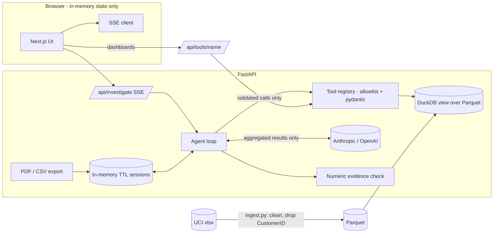
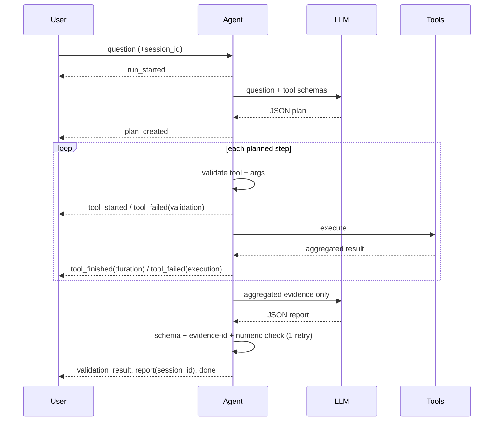

# OpsLens

**Don't just show me the numbers. Tell me what's going wrong.**

OpsLens is a business-intelligence investigation agent over the real UCI *Online Retail II* dataset. It plans an investigation, runs **allowlisted, validated analytical tools** (Python + DuckDB), checks every number in its report against the tool outputs, and streams its actual execution to the UI.

Stack: Next.js 14 + TypeScript + Tailwind + Recharts (frontend) · FastAPI + Pandas + DuckDB + PyArrow + Pydantic + ReportLab (backend) · Anthropic or OpenAI (optional, server-side).

## Quick start

```bash
# 1. Backend
cd backend
python -m venv .venv && source .venv/bin/activate
pip install -r requirements.txt
cp ../.env.example ../.env          # optionally add ANTHROPIC_API_KEY or OPENAI_API_KEY (server-side only)
python -m opslens.ingest --download # official UCI download (CC BY 4.0); see "Dataset" if blocked
set -a; source ../.env; set +a
uvicorn opslens.main:app --port 8000

# 2. Frontend (new terminal)
cd frontend
cp .env.example .env.local          # NEXT_PUBLIC_API_URL=http://localhost:8000 (not a secret)
npm install && npm run dev          # http://localhost:3000
```

Without an AI key everything works except free-text questions: Overview, Data Explorer, Insights, Reports/exports and the **seven preset scenarios** (clearly labelled *Scripted workflow (no AI)*) run real tools. With a key, free-text investigations use the real agent.

## Dataset

Source: https://archive.ics.uci.edu/dataset/502/online+retail+ii · Daqing Chen · DOI 10.24432/C5CG6D · **CC BY 4.0**. The workbook is **not** redistributed in this repo.

- Automatic: `python -m opslens.ingest --download`
- Manual: download the zip, put `online_retail_II.xlsx` in `data/raw/`, run `python -m opslens.ingest`
- Output: `data/processed/transactions.parquet` + `quality_report.json` (counts of every cleaning action). Raw data stays untouched in `data/raw/`.
- If the dataset is missing the API answers `503 dataset_not_ready` and the UI shows setup steps. **No substitute data is ever generated by the app.**
- **Validate against the real data** (run on a machine with network access): `python scripts/validate_real_dataset.py`

### Cleaning and definitions
Dropped: unparseable dates/quantities/prices, exact duplicates, negative prices. **Sale line** = not a cancellation (`Invoice` starting with `C`), quantity > 0, price > 0, real product code (5-digit prefix; postage/fees/adjustments/tests excluded). **Revenue** = quantity × unit price on sale lines (not profit). **Cancellation rate** = cancellation invoices ÷ (sale + cancellation invoices). `CustomerID` is counted for missingness then **dropped at ingestion**. Not answerable: profit/margin, marketing ROI, staff productivity, stock levels, customer-level analysis.

## Architecture





Without a provider the plan comes from the preset scenario's fixed tool chain, the report is built deterministically from tool outputs, and the UI labels it as scripted.

## Analytical tools

| Tool | Purpose | Arguments |
|---|---|---|
| `get_dataset_overview` | Headline KPIs: records, invoices, revenue, products, countries, date range. | none |
| `get_dataset_schema` | Columns, types and descriptions of the analysable dataset. | none |
| `get_data_quality_report` | Counts of cleaning actions and data-quality issues. | none |
| `get_revenue_summary` | Total revenue, invoices, units and average invoice value (optionally filtered). | country, end_month, start_month |
| `get_revenue_trend` | Monthly revenue with month-over-month change and significant declines. | country, decline_threshold_pct, end_month, start_month |
| `get_period_comparison` | Compare revenue/invoices/avg invoice between two month ranges (B vs baseline A). | a_end, a_start, b_end, b_start, country |
| `get_product_performance` | Top products by revenue or units, plus products whose revenue declined recently. | country, end_month, sort_by, start_month, top_n |
| `get_country_performance` | Revenue, share and average invoice by country. | country, end_month, start_month, top_n |
| `get_cancellation_analysis` | Cancellation invoices/value by month, peak months and most-cancelled products. | country, end_month, start_month, top_n |
| `get_quantity_analysis` | Distribution of units per sale line and monthly units. | country, end_month, start_month, top_n |
| `get_average_invoice_value` | Average and median invoice value overall and by month. | country, end_month, start_month |
| `get_invoice_analysis` | Invoice-level distribution: value percentiles, lines and units per invoice. | country, end_month, start_month |
| `get_product_concentration` | Share of revenue held by the top 1/5/10/20 products; products needed for 80% of revenue. | country, end_month, start_month |
| `get_seasonality_analysis` | Seasonal index by calendar month, weekday and hour patterns. | country, end_month, start_month |
| `get_anomaly_summary` | Unusual days or months by z-score of revenue or invoice count. | country, end_month, granularity, max_results, metric, start_month, z_threshold |
| `get_top_bottom_performers` | Top and bottom products, countries or months by revenue. | country, dimension, end_month, n, start_month |

All tools take optional filters (`start_month`, `end_month`, `country`) where applicable, use parameterised SQL over one fixed view, cap rows, and never return invoice numbers or customer identifiers.

## API

| Endpoint | Purpose |
|---|---|
| `GET /api/status` | dataset readiness, AI configured (provider name only), privacy notice, attribution |
| `GET /api/tools`, `GET /api/scenarios` | tool schemas; the 7 preset scenarios |
| `POST /api/tools/{name}` | run one validated tool (dashboards) |
| `POST /api/investigate` | **SSE** stream. Body: `{question?, scenario?, session_id?}`; extra fields (e.g. history/evidence) → 422 |
| `GET /api/explorer/preview?page&page_size` | paginated cleaned rows (no identifiers) |
| `GET /api/sessions/{sid}/turns/{n}/export.pdf` · `export.csv[?evidence=E1&table=monthly]` | exports built from the server-held validated report |
| `GET /api/export/tool/{name}.csv?table=…` | CSV of a dashboard table |

SSE events: `run_started, planning_started, plan_created, clarification, unsupported, tool_started, tool_finished, tool_failed, interpretation_started, validation_result, report, error, done`. Errors are `{"error":{"code","message"}}`.

## Five Non-Negotiable Engineering Rules

| # | Rule | Implementation | Verified by |
|---|---|---|---|
| 1 | Never fabricate dashboard data | UI renders only backend responses; missing data → setup/error state; unavailable values show `n/a`; synthetic data exists only inside `backend/tests/conftest.py` | `pages.test.tsx` (KPIs equal mocked backend values; 503 shows no figures), `rules.test.ts` (no hardcoded £/KPI literals), `test_data.py` (tool outputs equal independent pandas), `test_api.py::test_dataset_missing…` |
| 2 | Python does all numerics | Tools compute everything; `numcheck.py` rejects any figure in model prose not present in tool output (1 retry, then deterministic fallback) | `test_numcheck.py`, `test_agent.py` (unsupported number rejected → corrected / fallback; unknown evidence ids rejected) |
| 3 | Raw data never reaches the LLM | `CustomerID` dropped at ingestion; only aggregated tool outputs are prompted; `sanitize_for_llm` strips identifier-like keys and caps rows; privacy notice discloses provider transmission | `test_agent.py::test_llm_payloads_contain_no_raw_records_or_identifiers`, `test_sanitizer…`, `test_followup_exports.py` |
| 4 | No arbitrary SQL/Python | Strict tool allowlist, `extra=forbid` pydantic models, parameterised SQL, country validated against dataset values; no tool takes SQL/code/column names | `test_tools_security.py` (unknown tools, injection via country, schema has no code params) |
| 5 | No fake execution animations | Timeline is a pure reducer over received SSE events; spinner only between a real `tool_started` and its finish/fail event; failures shown as failures; no timers in agent UI code | `investigation.test.ts`, `pages.test.tsx` (honest failed-tool display, transport errors create no timeline), `rules.test.ts` (no setTimeout/setInterval), `test_agent.py` (event order, measured durations) |

### Follow-up security
Follow-up context is created **only by the server** from validated report events and held in an in-memory, TTL-bound (1 h), size-bounded session store addressed by an unguessable id. The client cannot send history or evidence (422) and cannot reference unknown sessions (410), so it cannot make the agent treat fabricated numbers as verified. Nothing is persisted; restarting the server clears all context. Tests: `test_followup_exports.py`.

## Privacy
No accounts, cookies, localStorage or database. Browser state is in memory (refresh clears it). API keys are server-side only. Logs record method/path/status only (no questions, prompts, keys or data). **Honest disclosure:** with an AI provider configured, your question and aggregated tool results (totals, monthly figures, top-N tables) are sent to that provider; raw transactions and customer/invoice identifiers are not. Preset scenarios send nothing to any provider.

## Testing
```bash
cd backend && python -m pytest -q                       # backend, API, SSE, privacy, exports, sessions
cd frontend && npm run typecheck && npm run lint && npm test && npm run build
python scripts/validate_real_dataset.py                 # needs the real dataset
python scripts/validate_providers.py                    # needs ANTHROPIC_API_KEY / OPENAI_API_KEY in env; skips providers without keys
```

## Deployment
Run the API (`uvicorn opslens.main:app --host 0.0.0.0 --port 8000`, behind TLS) and the frontend (`npm run build && npm start`) on any host or container platform. Set `NEXT_PUBLIC_API_URL` at **frontend build time**, `CORS_ORIGINS` to the frontend origin, provider keys as backend secrets, and mount/prepare `data/processed/` (run ingestion at deploy or bake it into the image; do not commit the dataset). Disable proxy buffering for `/api/investigate` (SSE). Sessions and rate limits are per-process, so use one worker or add sticky sessions/shared state when scaling out.

## Known limitations
- Tool selection uses a validated **JSON plan** from the model, not provider-native function-calling APIs; every call is still validated before execution.
- Rate limiting and sessions are in-process; restart clears sessions.
- Seasonality rests on two years (and a partial last month is excluded from trend logic); anomaly detection is a simple z-score.
- Insight headlines are templated from returned figures; PDF charts are simple bar charts.
- Numeric check tolerates rounding and small bare counts (≤12) in prose; it cannot judge whether a correct number is interpreted wisely.
- See "Verification status" for what has and has not been run.

## Verification status
See the delivery summary / `VERIFICATION.md`.
